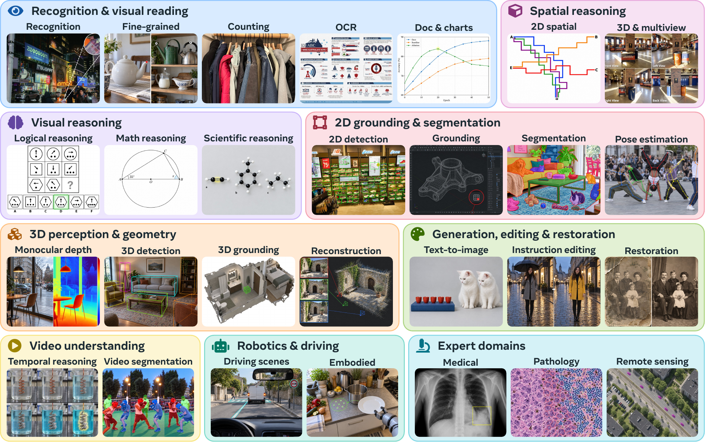

<h1 align="center">Hard Vision, Easy Vision: What GPT-6 Astra Reveals Across Computer Vision</h1>

<!--  -->
<p align="center">
    
</p>

<p align="center">
  <a href="https://scholar.google.com/citations?user=yhDdEuEAAAAJ&hl=en">Hanoona Rasheed</a><sup>1,†</sup>, <a href="https://scholar.google.com/citations?user=GJp0keYAAAAJ&hl=en">Mohammed Irfan Kurpath</a><sup>1,†</sup>, <a href="https://amazingren.github.io/">Bin Ren</a><sup>1</sup>,<br>
  <a href="https://scholar.google.com/citations?hl=en&user=bZ3YBRcAAAAJ">Hisham Cholakkal</a><sup>1</sup>, <a href="https://sites.google.com/view/fahadkhans/home?pli=1&authuser=0">Fahad Shahbaz Khan</a><sup>1,2</sup>, <a href="https://salman-h-khan.github.io/">Salman Khan</a><sup>1,2</sup>
</p>

<p align="center">
  <sup>1</sup>Mohamed bin Zayed University of Artificial Intelligence &nbsp;&nbsp; <sup>2</sup>Apertix &nbsp;&nbsp; <sup>†</sup>Equal contribution
</p>

<p align="center">
  <a href="https://arxiv.org/abs/2609.35718"><b>Paper</b></a> &nbsp;|&nbsp;
  <a href="https://mbzuai-oryx.github.io/frontier-vision/"><b>Project Page</b></a> &nbsp;|&nbsp;
  <a href="https://mbzuai-oryx.github.io/frontier-vision/blog"><b>Blog</b></a>
</p>

## News

**🔥 [Oct 2026]**

- [x] 📊 **Benchmark-level results are out!** Scores of all six systems on every benchmark. [Explore them →](https://mbzuai-oryx.github.io/frontier-vision/benchmarks/)
- [x] 🚀 **We release our evaluation details!** The exact prompts and model settings behind our evaluation. [See below ↓](#evaluation-details)
- [x] 🎬 **Watch GPT-6 Astra reason!** New videos show it building detections, masks and depth maps step by step. [Check out the gallery →](https://mbzuai-oryx.github.io/frontier-vision/#gallery)

<p align="center">
  
</p>

**Mapping the changing landscape of general-purpose vision.** Our study covers 34 capabilities across nine broad areas of computer vision, drawing on 55 benchmarks; representative tasks are illustrated here. We compare frontier systems with specialist models and human performance to examine how much of computer vision is now accessible through a general-purpose interface, where meaningful gaps remain, and where dedicated vision models are still necessary.

## Evaluation details

[`evaluation-details/`](evaluation-details/) holds the prompts and inference settings used in our evaluation, grouped by area. Each benchmark folder contains:

| File | Contents |
|---|---|
| `README.md` | Data source, revision, split and size, and how answers are scored |
| `prompt.md` | The prompt: system text, per-item user turn and, where used, tool definitions and output schema |
| `models.yaml` | Settings per model: reasoning effort, output-token limit, image detail and tools |
| `split.json` | For benchmarks evaluated on a fixed subset (Anywhere3D-v2, Omni3D, DIODE, VSI-Bench, RefSegRS, M3D-Bench REC, OCHuman): the item ids, with the selection described in the benchmark's README |

No benchmark data is included; images, videos and annotations must be downloaded from the original sources under their own licences.

## Citation

If you find this work useful, please cite:

```bibtex
@article{rasheed2026frontiervision,
  title   = {Hard Vision, Easy Vision: What GPT-6 Astra Reveals Across Computer Vision},
  author  = {Rasheed, Hanoona and Kurpath, Mohammed Irfan and Ren, Bin and Cholakkal, Hisham and Khan, Fahad Shahbaz and Khan, Salman},
  journal = {arXiv preprint arXiv:2609.35718},
  year    = {2026}
}
```
